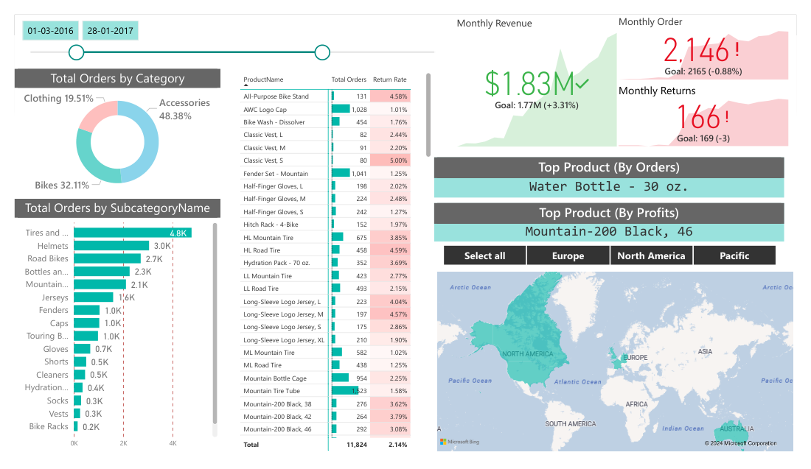
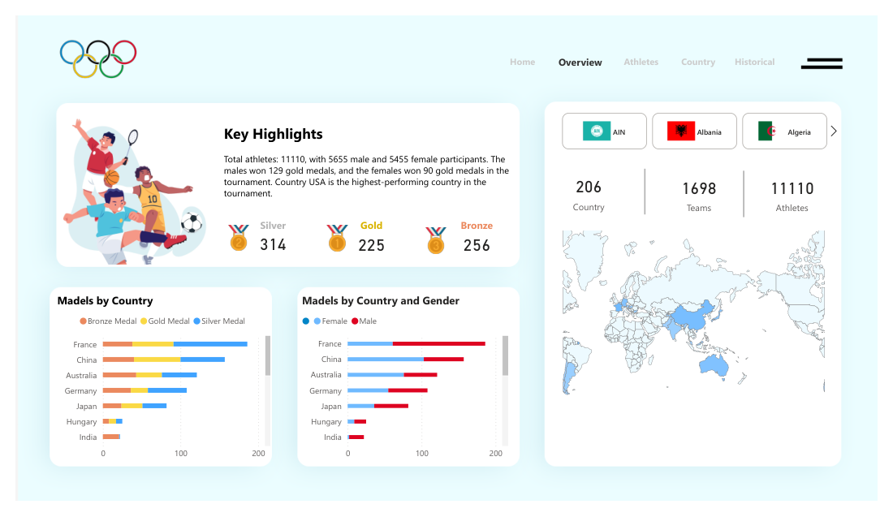

# 📊 Power BI & Data Analytics Portfolio

Collection of **Power BI** projects covering data modeling (star schema), **DAX**, Power Query, SQL and Python integration, and dashboard design for different business domains.

Built by **Vitor Chavernue**, Senior Data Engineer & Data Analyst with 15 years of experience in data projects, from ingestion and transformation to modeling and visualization.

---

## 📁 Projects

| Project | Business question | Solution | Highlights |
|---|---|---|---|
| [**AdventureWorks Sales Dashboard**](Visualizing-Microsoft-AdventureWorks-Data/Documentation.md) | Are we hitting revenue and order targets, and which products drive returns? | Executive report with targets, month-over-month comparison and return rate by product | Star schema, time intelligence, what-if price simulation |
| [**Paris 2024 Olympics**](Paris-2024-Olympics/Documentation.md) | Which countries and athletes performed best, and how does it compare historically? | Medal, athlete and country analysis with a historical view | Measures table, dynamic KPI text, custom navigation |
| [**Starbucks Drinks Nutrition**](Starbucks-Drinks-Dashboard/Documentation.md) | Which drinks are best for caffeine, protein or fewer calories? | Nutrient rankings by category and preparation type | Combined charts, Python data generator |
| [**AdventureWorks SQL**](AdventureWorksSQL/) | How do sales and customers evolve over time? | SQL Server extraction feeding a Power BI sales model | SQL-based ETL into Power BI |
| [**SQL Training Demo**](SQL-Training-Demo/) | How to answer analytical questions directly in SQL? | Analytical query patterns feeding the report | Joins, aggregations, window logic |
| [**Power BI with Python**](Power-BI-with-Python/) | How to clean data that Power Query alone handles poorly? | Python scripts embedded in the Power BI refresh | pandas transformations inside Power BI |
| [**Financial Report Sample**](Financial-Report-Sample/) | Is the business profitable, and where do expenses grow? | Revenue vs. expenses and profitability KPIs | Financial KPIs, variance analysis |

---

## 🖼️ Previews

**AdventureWorks — Executive Summary**

**Paris 2024 Olympics — Overview**

**Starbucks — Nutrition Insights**

---

## 🛠️ Tech Stack

- **BI:** Power BI (Power Query M, DAX, data modeling, bookmarks, what-if parameters)
- **Databases:** SQL Server
- **Languages:** SQL, Python (pandas)
- **Concepts:** ETL, star schema, time intelligence, data storytelling

---

## ▶️ How to Use

1. Clone or download the repository.
2. Open the `.pbix` file of the desired project in **Power BI Desktop**.
3. Each project folder contains its data (`Data/`), previews (`Previews/`) and documentation (`Documentation.md`) when available.

---

## 🔗 Other Projects

- [**Data Lakehouse on Databricks**](https://github.com/vitorchavernue/DataLake_In_DataBricks) — Medallion architecture with PySpark, Delta Lake and star schema
- [**Public Budget Execution Dashboard**](https://github.com/vitorchavernue/public-budget-execution-powerbi) — Power BI analysis of Brazilian public spending with official government data

---

## 📬 Contact

[LinkedIn](https://www.linkedin.com/in/vitorchavernue/) · vitor.chavernue@gmail.com
