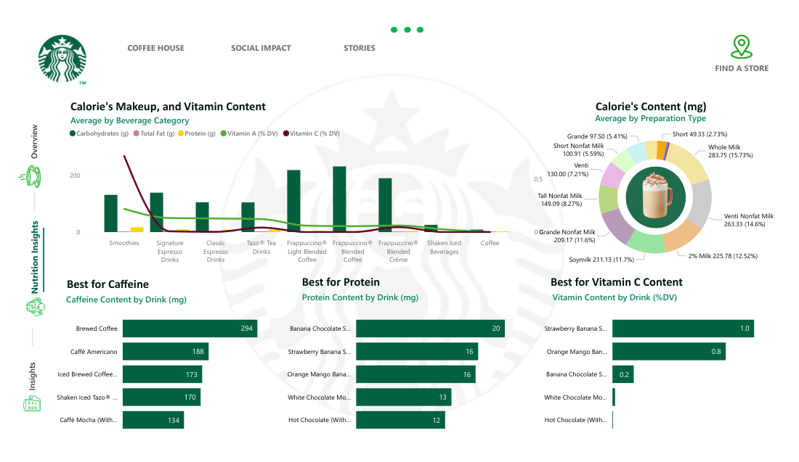

# Starbucks Drinks Nutrition Dashboard

Power BI report exploring the **nutritional profile of Starbucks beverages**: calories, macronutrients, vitamins and caffeine by beverage category and preparation type.

## Report Pages
| Page | Content |
|---|---|
| **Overview** | General view of the beverage menu |
| **Calorific Value Index** | Calories, carbohydrates, fat, protein and vitamins by category and preparation |
| **Quality Composition** | Sugars, saturated and trans fat, caffeine, iron and vitamins by beverage |
| **Store** | Store locator page |

## Data
- `Data/beverages_data.csv`: beverage nutrition data (category, beverage, preparation and nutrients).
- `Scripts/dummy_data_generator.py`: Python script (pandas + Faker) that generates synthetic data with the same structure, used for testing the model.

## Highlights
- Ranking visuals ("Best for Caffeine", "Best for Protein", "Best for Vitamin C").
- Combined bar/line charts to compare nutrients across categories.
- Branded layout with side navigation.

## Previews
Full report preview: [`Previews/previews.pdf`](Previews/previews.pdf)
